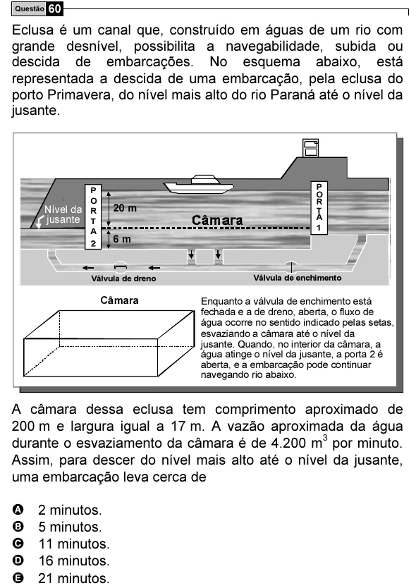

Texto extraído (pode conter ruído)

Questão 60  
Eclusa é um canal que, construído em águas de um rio com  
grande desnível, possibilita a navegabilidade, subida ou  
descida de embarcações. No esquema abaixo, está  
representada a descida de uma embarcação, pela eclusa do  
porto Primavera, do nível mais alto do rio Paraná até o nível da  
jusante.  
P  
P  
O  
O  
20 m  
R  
Nível da  
R  
T  
jusante  
A  
T  
A  
1  
6 m  
Válvula de dreno  
Válvula de enchimento  
Câmara  
Enquanto a válvula de enchimento está  
fechada e a de dreno, aberta, o fluxo de  
água ocorre no sentido indicado pelas setas,  
esvaziando a câmara até o nível da  
jusante. Quando, no interior da câmara, a  
água atinge o nível da jusante, a porta 2 é  
aberta, e a embarcação pode continuar  
navegando rio abaixo.  
A câmara dessa eclusa tem comprimento aproximado de  
200 m e largura igual a 17 m. A vazão aproximada da água  
durante o esvaziamento da câmara é de 4.200 m 3 por minuto.  
Assim, para descer do nível mais alto até o nível da jusante,  
uma embarcação leva cerca de  
A  
2 minutos.  
B  
5 minutos.  
C  
11 minutos.  
D  
16 minutos.  
E  
21 minutos.

