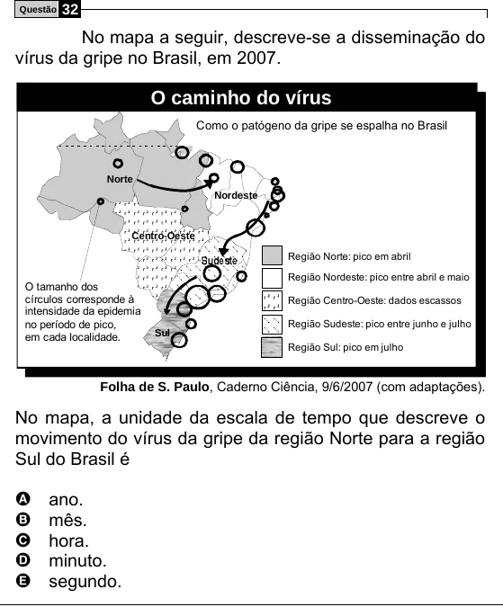

Texto extraído (pode conter ruído)

Questão  
32  
No mapa a seguir, descreve-se a disseminação do  
vírus da gripe no Brasil, em 2007.  
O caminho do vírus  
Como o patógeno da gripe se espalha no Brasil  
Norte  
Nordeste  
Centro-Oeste  
Região Norte: pico em abril  
Região Nordeste: pico entre abril e maio  
O tamanho dos  
círculos corresponde à  
Região Centro-Oeste: dados escassos  
intensidade da epidemia  
no período de pico,  
Região Sudeste: pico entre junho e julho  
Sul  
em cada localidade.  
Região Sul: pico em julho  
Folha de S. Paulo, Caderno Ciência, 9/6/2007 (com adaptações).  
No mapa, a unidade da escala de tempo que descreve o  
movimento do vírus da gripe da região Norte para a região  
Sul do Brasil é  
A  
ano.  
B  
mês.  
hora.  
C  
D  
minuto.  
E  
segundo.

