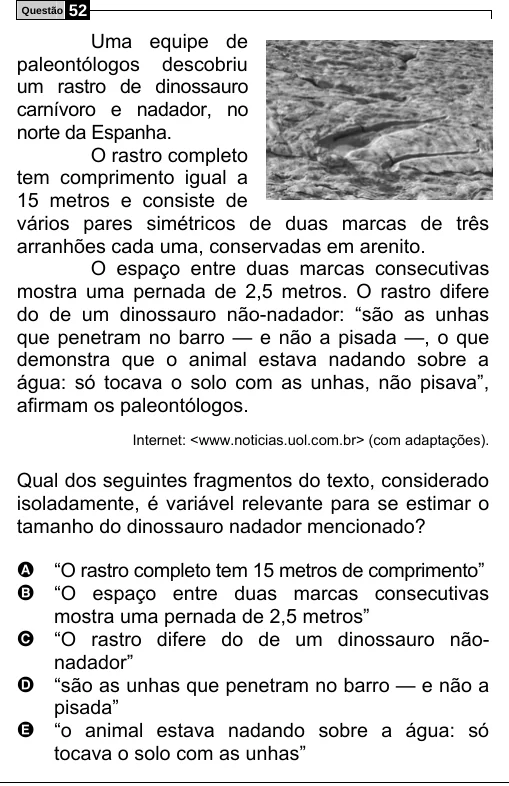

Texto extraído (pode conter ruído)

Questão  
52  
Uma equipe de  
paleontólogos descobriu  
um rastro de dinossauro  
carnívoro e nadador, no  
norte da Espanha.  
O rastro completo  
tem comprimento igual a  
15 metros e consiste de  
vários pares simétricos de duas marcas de três  
arranhões cada uma, conservadas em arenito.  
O espaço entre duas marcas consecutivas  
mostra uma pernada de 2,5 metros. O rastro difere  
do de um dinossauro não-nadador: “são as unhas  
que penetram no barro — e não a pisada —, o que  
demonstra que o animal estava nadando sobre a  
água: só tocava o solo com as unhas, não pisava”,  
afirmam os paleontólogos.  
Internet: <www.noticias.uol.com.br> (com adaptações).  
Qual dos seguintes fragmentos do texto, considerado  
isoladamente, é variável relevante para se estimar o  
tamanho do dinossauro nadador mencionado?  
A “O rastro completo tem 15 metros de comprimento”  
B “O espaço entre duas marcas consecutivas  
mostra uma pernada de 2,5 metros”  
C “O rastro difere do de um dinossauro não-  
nadador”  
D “são as unhas que penetram no barro — e não a  
pisada”  
E “o animal estava nadando sobre a água: só  
tocava o solo com as unhas”

