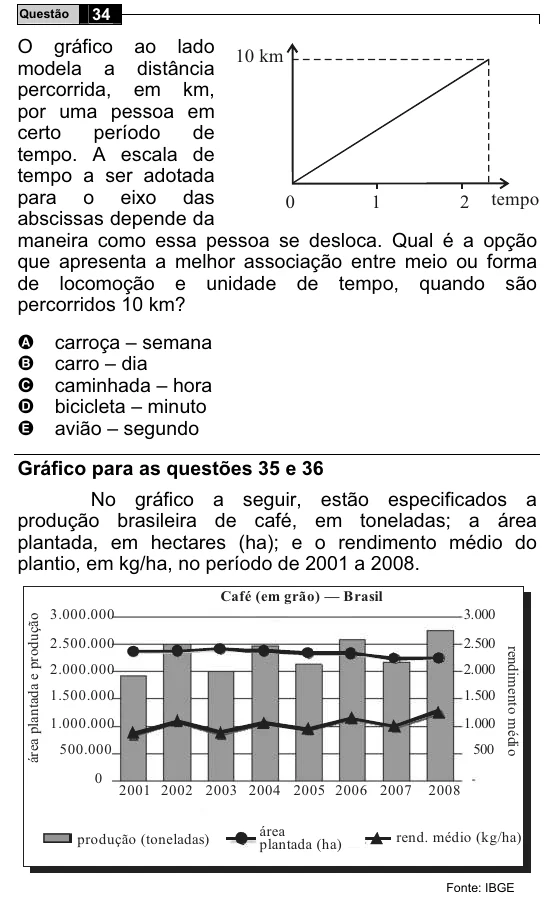

Texto extraído (pode conter ruído)

34  
Questão  
O gráfico ao lado 10 km  
modela a distância  
percorrida, em km,  
por uma pessoa em  
certo  
período  
de  
tempo. A escala de  
tempo a ser adotada  
para o eixo das  
2 tempo  
0  
1  
abscissas depende da  
maneira como essa pessoa se desloca. Qual é a opção  
que apresenta a melhor associação entre meio ou forma  
de locomoção e unidade de tempo, quando são  
percorridos 10 km?  
A  
carroça – semana  
B  
carro – dia  
caminhada – hora  
C  
D  
bicicleta – minuto  
avião – segundo  
E  
Gráfico para as questões 35 e 36  
No gráfico a seguir, estão especificados a  
produção brasileira de café, em toneladas; a área  
plantada, em hectares (ha); e o rendimento médio do  
plantio, em kg/ha, no período de 2001 a 2008.  
Café (em grão) — Brasil  
3.000.000  
3.000  
área plantada e produção  
2.500.000  
2.500  
rendimento médio  
2.000.000  
2.000  
1.500.000  
1.500  
1.000.000  
1.000  
500.000  
500  
0  
2001 2002 2003 2004 2005 2006 2007  
2008  
área  
produção (toneladas)  
rend. médio (kg/ha)  
plantada (ha)  
Fonte: IBGE

