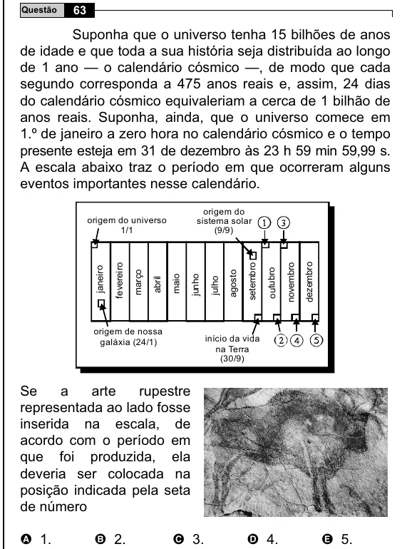

Texto extraído (pode conter ruído)

Questão  
63  
Suponha que o universo tenha 15 bilhões de anos  
de idade e que toda a sua história seja distribuída ao longo  
de 1 ano — o calendário cósmico —, de modo que cada  
segundo corresponda a 475 anos reais e, assim, 24 dias  
do calendário cósmico equivaleriam a cerca de 1 bilhão de  
anos reais. Suponha, ainda, que o universo comece em  
1.º de janeiro a zero hora no calendário cósmico e o tempo  
presente esteja em 31 de dezembro às 23 h 59 min 59,99 s.  
A escala abaixo traz o período em que ocorreram alguns  
eventos importantes nesse calendário.  
origem do  
origem do universo  
sistema solar  
1/1  
(9/9)  
dezembro  
janeiro  
fevereiro  
setembro  
novembro  
março  
agosto  
outubro  
maio  
junho  
abril  
julho  
origem de nossa  
galáxia (24/1)  
início da vida  
na Terra  
(30/9)  
Se  
a  
arte  
rupestre  
representada ao lado fosse  
inserida na escala, de  
acordo com o período em  
que foi produzida, ela  
deveria ser colocada na  
posição indicada pela seta  
de número  
A 1.  
B 2.  
C 3.  
D 4.  
E 5.

