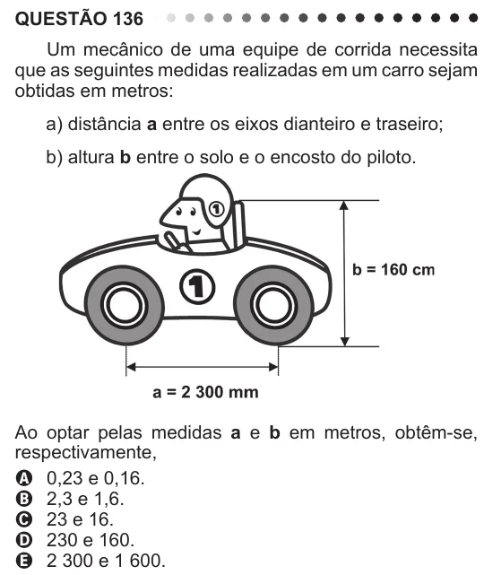

Texto extraído (pode conter ruído)

QUESTÃO 136  
Um mecânico de uma equipe de corrida necessita  
que as seguintes medidas realizadas em um carro sejam  
obtidas em metros:  
a) distância a entre os eixos dianteiro e traseiro;  
b) altura b entre o solo e o encosto do piloto.  
Ao optar pelas medidas a e b em metros, obtêm-se,  
respectivamente,  
A 0,23 e 0,16.  
B 2,3 e 1,6.  
C 23 e 16.  
D 230 e 160.  
E 2 300 e 1 600.

