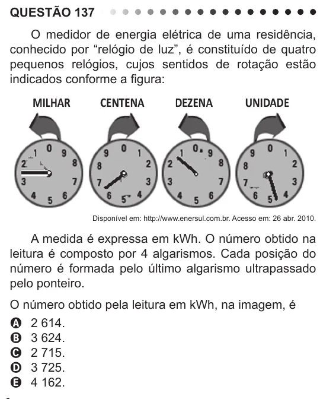

Texto extraído (pode conter ruído)

QUESTÃO 137  
O medidor de energia elétrica de uma residência,  
conhecido por “relógio de luz”, é constituído de quatro  
pequenos relógios, cujos sentidos de rotação estão  
indicados conforme a figura:  
Disponível em: http://www.enersul.com.br. Acesso em: 26 abr. 2010.  
A medida é expressa em kWh. O número obtido na  
leitura é composto por 4 algarismos. Cada posição do  
número é formada pelo último algarismo ultrapassado  
pelo ponteiro.  
O número obtido pela leitura em kWh, na imagem, é  
A 2 614.  
B 3 624.  
C 2 715.  
D 3 725.  
E 4 162.

