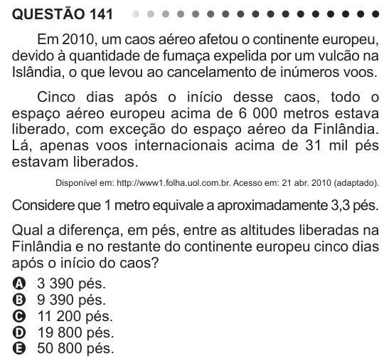

Texto extraído (pode conter ruído)

QUESTÃO 141  
Em 2010, um caos aéreo afetou o continente europeu,  
devido à quantidade de fumaça expelida por um vulcão na  
Islândia, o que levou ao cancelamento de inúmeros voos.  
Cinco dias após o início desse caos, todo o  
espaço aéreo europeu acima de 6 000 metros estava  
liberado, com exceção do espaço aéreo da Finlândia.  
Lá, apenas voos internacionais acima de 31 mil pés  
estavam liberados.  
Disponível em: http://www1.folha.uol.com.br. Acesso em: 21 abr. 2010 (adaptado).  
Considere que 1 metro equivale a aproximadamente 3,3 pés.  
Qual a diferença, em pés, entre as altitudes liberadas na  
Finlândia e no restante do continente europeu cinco dias  
após o início do caos?  
A 3 390 pés.  
B 9 390 pés.  
C 11 200 pés.  
D 19 800 pés.  
E 50 800 pés.

