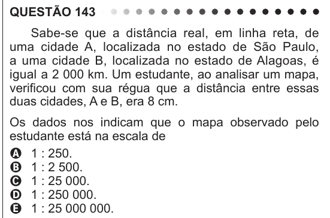

Texto extraído (pode conter ruído)

QUESTÃO 143  
Sabe-se que a distância real, em linha reta, de  
uma cidade A, localizada no estado de São Paulo,  
a uma cidade B, localizada no estado de Alagoas, é  
igual a 2 000 km. Um estudante, ao analisar um mapa,  
verificou com sua régua que a distância entre essas  
duas cidades, A e B, era 8 cm.  
Os dados nos indicam que o mapa observado pelo  
estudante está na escala de  
A 1 : 250.  
B 1 : 2 500.  
C 1 : 25 000.  
D 1 : 250 000.  
E 1 : 25 000 000.

