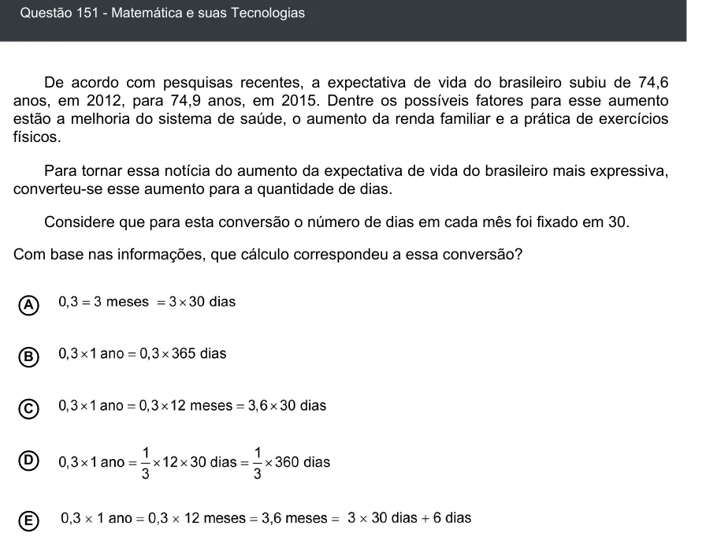

Texto extraído (pode conter ruído)

Questão 151 - Matemática e suas Tecnologias  
De acordo com pesquisas recentes, a expectativa de vida do brasileiro subiu de 74,6  
anos, em 2012, para 74,9 anos, em 2015. Dentre os possíveis fatores para esse aumento  
estão a melhoria do sistema de saúde, o aumento da renda familiar e a prática de exercícios  
físicos.  
Para tornar essa notícia do aumento da expectativa de vida do brasileiro mais expressiva,  
converteu-se esse aumento para a quantidade de dias.  
Considere que para esta conversão o número de dias em cada mês foi fixado em 30.  
Com base nas informações, que cálculo correspondeu a essa conversão?  
A  
B  
C  
D  
E

