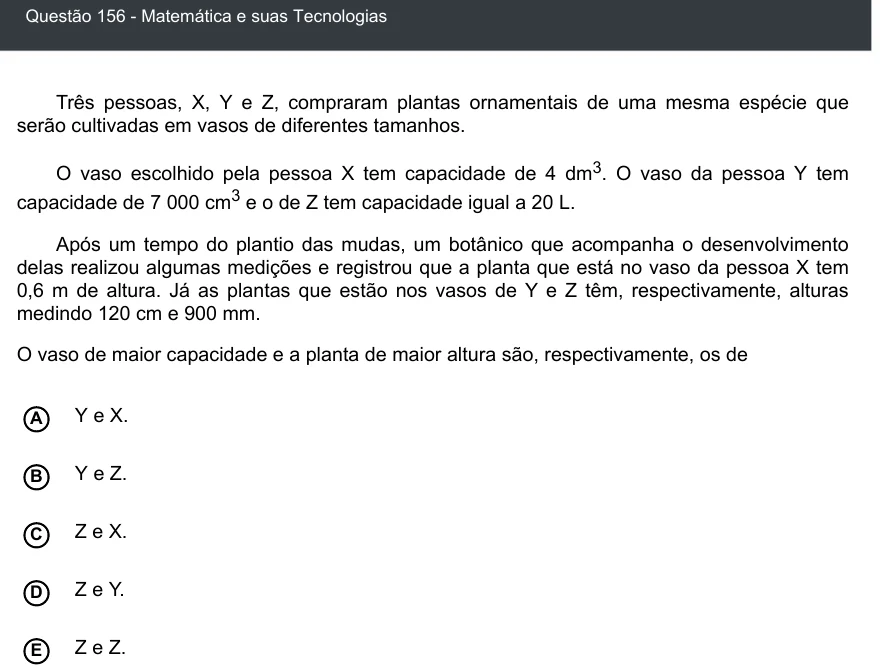

Texto extraído (pode conter ruído)

Questão 156 - Matemática e suas Tecnologias  
Três pessoas, X, Y e Z, compraram plantas ornamentais de uma mesma espécie que  
serão cultivadas em vasos de diferentes tamanhos.  
O vaso escolhido pela pessoa X tem capacidade de 4 dm 3 . O vaso da pessoa Y tem  
capacidade de 7 000 cm 3 e o de Z tem capacidade igual a 20 L.  
Após um tempo do plantio das mudas, um botânico que acompanha o desenvolvimento  
delas realizou algumas medições e registrou que a planta que está no vaso da pessoa X tem  
0,6 m de altura. Já as plantas que estão nos vasos de Y e Z têm, respectivamente, alturas  
medindo 120 cm e 900 mm.  
O vaso de maior capacidade e a planta de maior altura são, respectivamente, os de  
Y e X.  
A  
Y e Z.  
B  
Z e X.  
C  
D  
Z e Y.  
Z e Z.  
E

