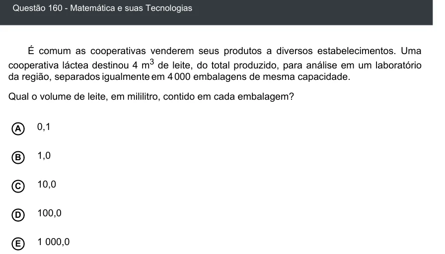

Texto extraído (pode conter ruído)

Questão 160 - Matemática e suas Tecnologias  
É comum as cooperativas venderem seus produtos a diversos estabelecimentos. Uma  
cooperativa láctea destinou 4 m 3 de leite, do total produzido, para análise em um laboratório  
da região, separados igualmente em 4 000 embalagens de mesma capacidade.  
Qual o volume de leite, em mililitro, contido em cada embalagem?  
0,1  
A  
B  
1,0  
10,0  
C  
100,0  
D  
1 000,0  
E

