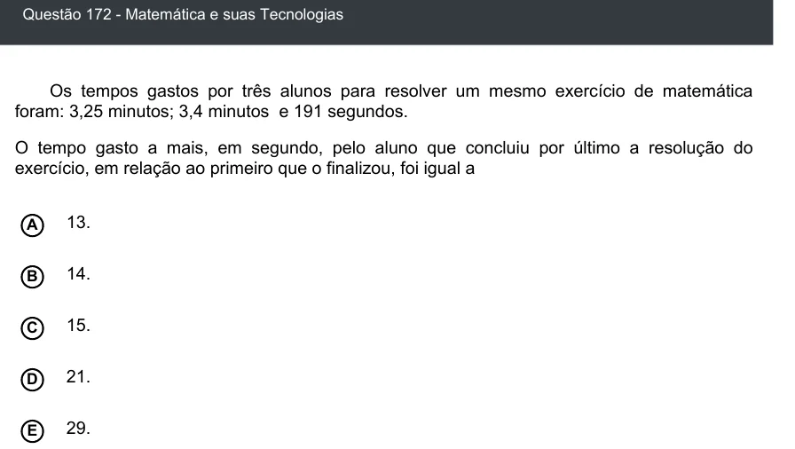

Texto extraído (pode conter ruído)

Questão 172 - Matemática e suas Tecnologias  
Os tempos gastos por três alunos para resolver um mesmo exercício de matemática  
foram: 3,25 minutos; 3,4 minutos e 191 segundos.  
O tempo gasto a mais, em segundo, pelo aluno que concluiu por último a resolução do  
exercício, em relação ao primeiro que o finalizou, foi igual a  
13.  
A  
B  
14.  
15.  
C  
21.  
D  
E  
29.

