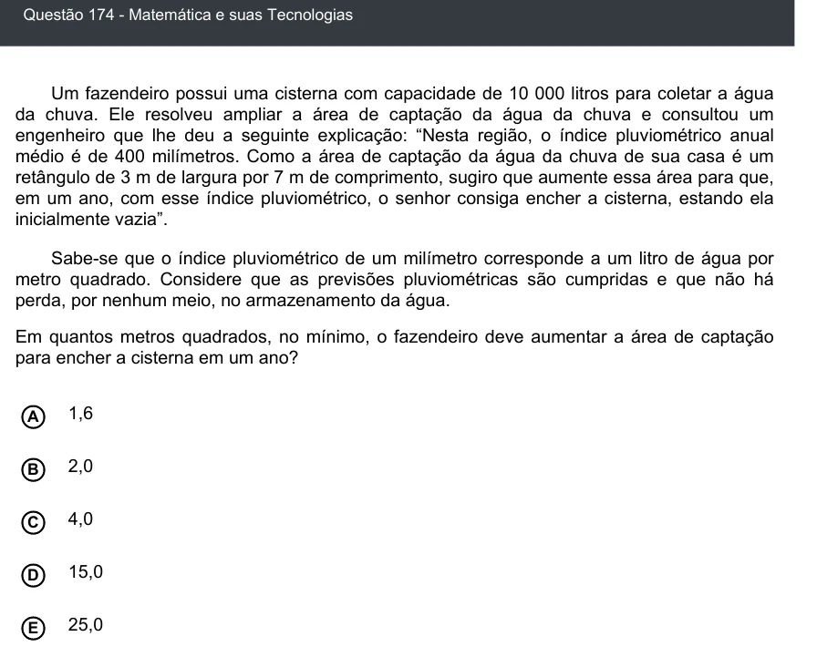

Texto extraído (pode conter ruído)

Questão 174 - Matemática e suas Tecnologias  
Um fazendeiro possui uma cisterna com capacidade de 10 000 litros para coletar a água  
da chuva. Ele resolveu ampliar a área de captação da água da chuva e consultou um  
engenheiro que lhe deu a seguinte explicação: “Nesta região, o índice pluviométrico anual  
médio é de 400 milímetros. Como a área de captação da água da chuva de sua casa é um  
retângulo de 3 m de largura por 7 m de comprimento, sugiro que aumente essa área para que,  
em um ano, com esse índice pluviométrico, o senhor consiga encher a cisterna, estando ela  
inicialmente vazia”.  
Sabe-se que o índice pluviométrico de um milímetro corresponde a um litro de água por  
metro quadrado. Considere que as previsões pluviométricas são cumpridas e que não há  
perda, por nenhum meio, no armazenamento da água.  
Em quantos metros quadrados, no mínimo, o fazendeiro deve aumentar a área de captação  
para encher a cisterna em um ano?  
1,6  
A  
2,0  
B  
C  
4,0  
15,0  
D  
25,0  
E

