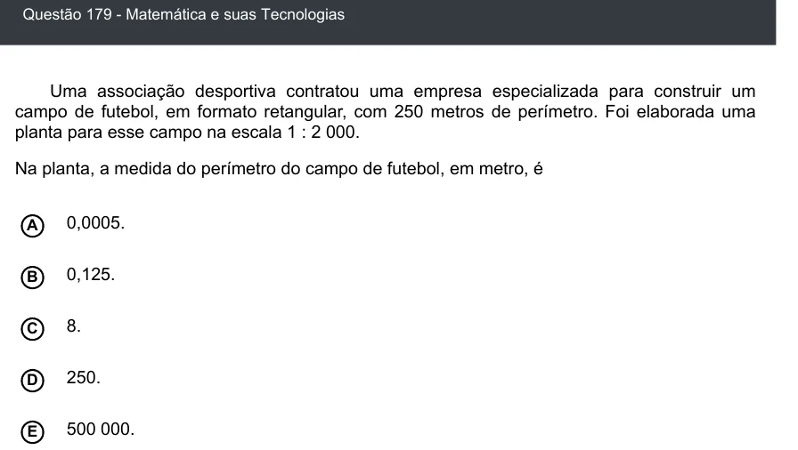

Texto extraído (pode conter ruído)

Questão 179 - Matemática e suas Tecnologias  
Uma associação desportiva contratou uma empresa especializada para construir um  
campo de futebol, em formato retangular, com 250 metros de perímetro. Foi elaborada uma  
planta para esse campo na escala 1 : 2 000.  
Na planta, a medida do perímetro do campo de futebol, em metro, é  
0,0005.  
A  
B  
0,125.  
8.  
C  
250.  
D  
E  
500 000.

