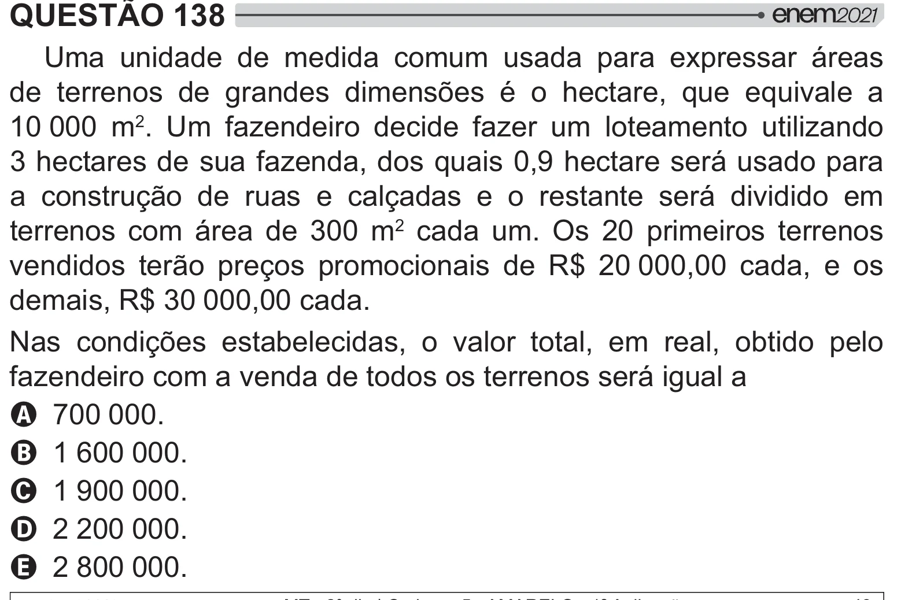

Texto extraído (pode conter ruído)

QUESTÃO 138  
Uma unidade de medida comum usada para expressar áreas  
de terrenos de grandes dimensões é o hectare, que equivale a  
10 000 m 2 . Um fazendeiro decide fazer um loteamento utilizando  
3 hectares de sua fazenda, dos quais 0,9 hectare será usado para  
a construção de ruas e calçadas e o restante será dividido em  
terrenos com área de 300 m 2 cada um. Os 20 primeiros terrenos  
vendidos terão preços promocionais de R$ 20 000,00 cada, e os  
demais, R$ 30 000,00 cada.  
Nas condições estabelecidas, o valor total, em real, obtido pelo  
fazendeiro com a venda de todos os terrenos será igual a  
A 700 000.  
B 1 600 000.  
C 1 900 000.  
D 2 200 000.  
E 2 800 000.

