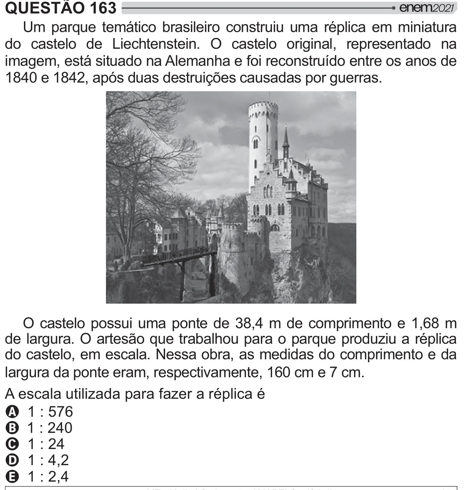

Texto extraído (pode conter ruído)

QUESTÃO 163  
Um parque temático brasileiro construiu uma réplica em miniatura  
do castelo de Liechtenstein. O castelo original, representado na  
imagem, está situado na Alemanha e foi reconstruído entre os anos de  
1840 e 1842, após duas destruições causadas por guerras.  
O castelo possui uma ponte de 38,4 m de comprimento e 1,68 m  
de largura. O artesão que trabalhou para o parque produziu a réplica  
do castelo, em escala. Nessa obra, as medidas do comprimento e da  
largura da ponte eram, respectivamente, 160 cm e 7 cm.  
A escala utilizada para fazer a réplica é  
A 1 : 576  
B 1 : 240  
C 1 : 24  
D 1 : 4,2  
E 1 : 2,4

