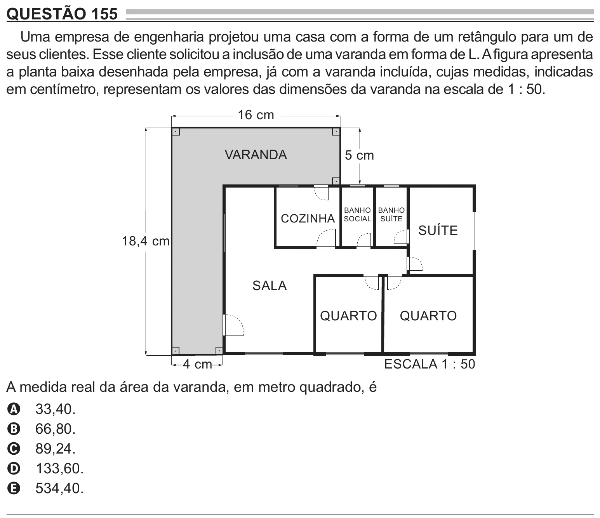

Texto extraído (pode conter ruído)

QUESTÃO 155  
Uma empresa de engenharia projetou uma casa com a forma de um retângulo para um de  
seus clientes. Esse cliente solicitou a inclusão de uma varanda em forma de L. A figura apresenta  
a planta baixa desenhada pela empresa, já com a varanda incluída, cujas medidas, indicadas  
em centímetro, representam os valores das dimensões da varanda na escala de 1 : 50.  
16 cm  
VARANDA  
5 cm  
BANHO BANHO  
COZINHA  
SOCIAL SUÍTE  
SUÍTE  
18,4 cm  
SALA  
QUARTO  
QUARTO  
4 cm  
ESCALA 1 : 50  
A medida real da área da varanda, em metro quadrado, é  
33,40.  
A  
66,80.  
B  
89,24.  
C  
133,60.  
D  
534,40.  
E

