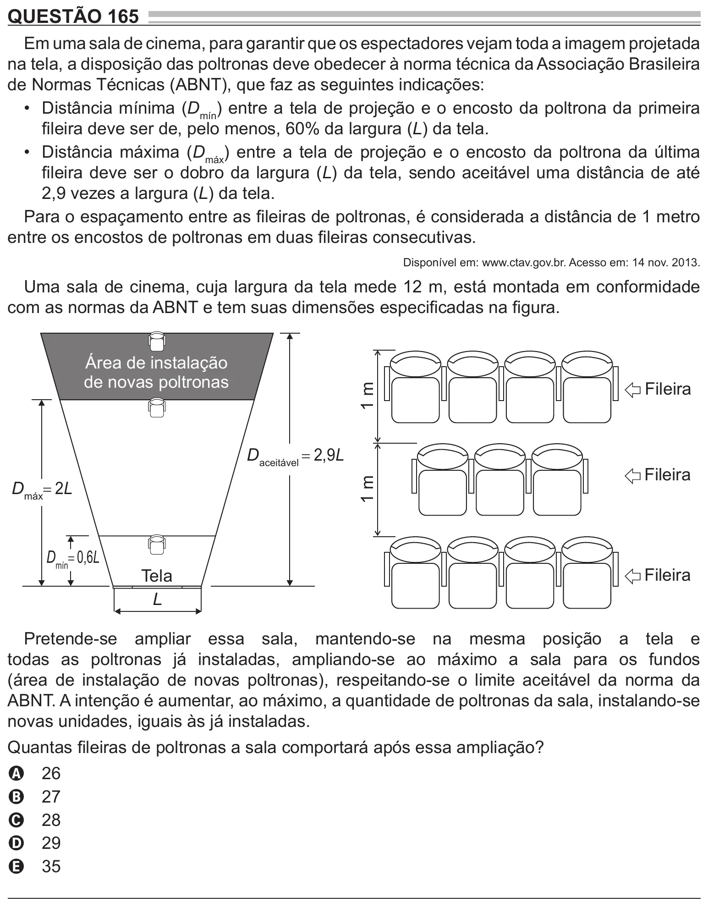

Texto extraído (pode conter ruído)

QUESTÃO 165  
Em uma sala de cinema, para garantir que os espectadores vejam toda a imagem projetada  
na tela, a disposição das poltronas deve obedecer à norma técnica da Associação Brasileira  
de Normas Técnicas (ABNT), que faz as seguintes indicações:  
• Distância mínima (D mín ) entre a tela de projeção e o encosto da poltrona da primeira  
fileira deve ser de, pelo menos, 60% da largura (L) da tela.  
• Distância máxima (D máx ) entre a tela de projeção e o encosto da poltrona da última  
fileira deve ser o dobro da largura (L) da tela, sendo aceitável uma distância de até  
2,9 vezes a largura (L) da tela.  
Para o espaçamento entre as fileiras de poltronas, é considerada a distância de 1 metro  
entre os encostos de poltronas em duas fileiras consecutivas.  
Disponível em: www.ctav.gov.br. Acesso em: 14 nov. 2013.  
Uma sala de cinema, cuja largura da tela mede 12 m, está montada em conformidade  
com as normas da ABNT e tem suas dimensões especificadas na figura.  
Área de instalação  
de novas poltronas  
Fileira  
1 m  
D aceitável = 2,9L  
Fileira  
1 m  
D máx = 2L  
D mín = 0,6L  
Tela  
Fileira  
L  
Pretende-se ampliar essa sala, mantendo-se na mesma posição a tela e  
todas as poltronas já instaladas, ampliando-se ao máximo a sala para os fundos  
(área de instalação de novas poltronas), respeitando-se o limite aceitável da norma da  
ABNT. A intenção é aumentar, ao máximo, a quantidade de poltronas da sala, instalando-se  
novas unidades, iguais às já instaladas.  
Quantas fileiras de poltronas a sala comportará após essa ampliação?  
26  
A  
27  
B  
28  
C  
29  
D  
35  
E

