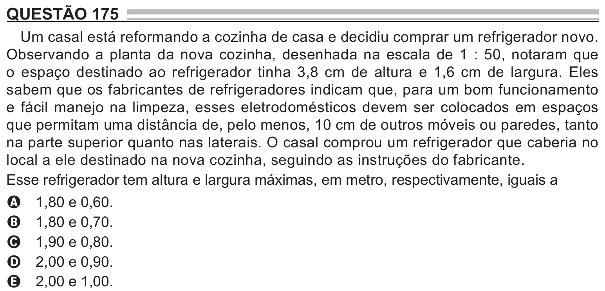

Texto extraído (pode conter ruído)

QUESTÃO 175  
Um casal está reformando a cozinha de casa e decidiu comprar um refrigerador novo.  
Observando a planta da nova cozinha, desenhada na escala de 1 : 50, notaram que  
o espaço destinado ao refrigerador tinha 3,8 cm de altura e 1,6 cm de largura. Eles  
sabem que os fabricantes de refrigeradores indicam que, para um bom funcionamento  
e fácil manejo na limpeza, esses eletrodomésticos devem ser colocados em espaços  
que permitam uma distância de, pelo menos, 10 cm de outros móveis ou paredes, tanto  
na parte superior quanto nas laterais. O casal comprou um refrigerador que caberia no  
local a ele destinado na nova cozinha, seguindo as instruções do fabricante.  
Esse refrigerador tem altura e largura máximas, em metro, respectivamente, iguais a  
1,80 e 0,60.  
A  
1,80 e 0,70.  
B  
1,90 e 0,80.  
C  
2,00 e 0,90.  
D  
2,00 e 1,00.  
E

