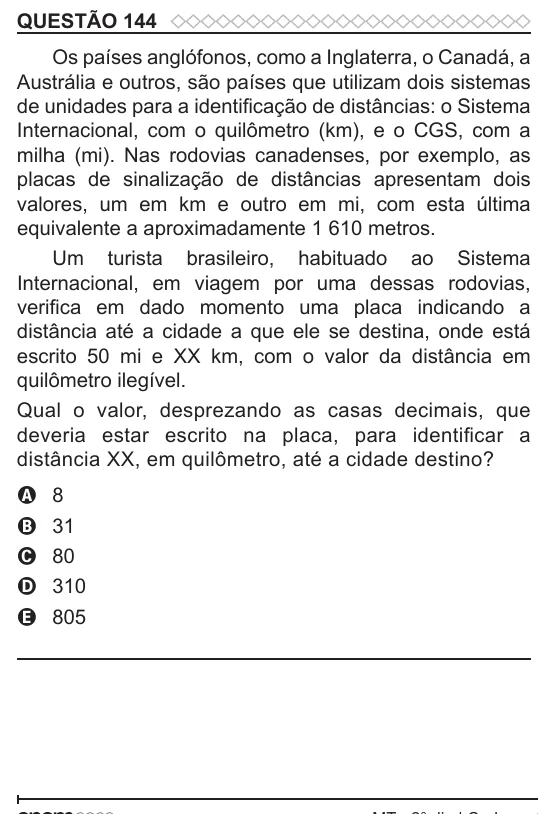

Texto extraído (pode conter ruído)

QUESTÃO 144  
Os países anglófonos, como a Inglaterra, o Canadá, a  
Austrália e outros, são países que utilizam dois sistemas  
de unidades para a identificação de distâncias: o Sistema  
Internacional, com o quilômetro (km), e o CGS, com a  
milha (mi). Nas rodovias canadenses, por exemplo, as  
placas de sinalização de distâncias apresentam dois  
valores, um em km e outro em mi, com esta última  
equivalente a aproximadamente 1 610 metros.  
Um turista brasileiro, habituado ao Sistema  
Internacional, em viagem por uma dessas rodovias,  
verifica em dado momento uma placa indicando a  
distância até a cidade a que ele se destina, onde está  
escrito 50 mi e XX km, com o valor da distância em  
quilômetro ilegível.  
Qual o valor, desprezando as casas decimais, que  
deveria estar escrito na placa, para identificar a  
distância XX, em quilômetro, até a cidade destino?  
8  
A  
31  
B  
80  
C  
310  
D  
805  
E

