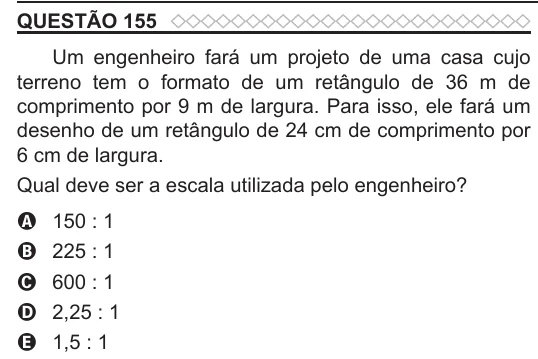

Texto extraído (pode conter ruído)

QUESTÃO 155  
Um engenheiro fará um projeto de uma casa cujo  
terreno tem o formato de um retângulo de 36 m de  
comprimento por 9 m de largura. Para isso, ele fará um  
desenho de um retângulo de 24 cm de comprimento por  
6 cm de largura.  
Qual deve ser a escala utilizada pelo engenheiro?  
150 : 1  
A  
B  
225 : 1  
600 : 1  
C  
2,25 : 1  
D  
1,5 : 1  
E

