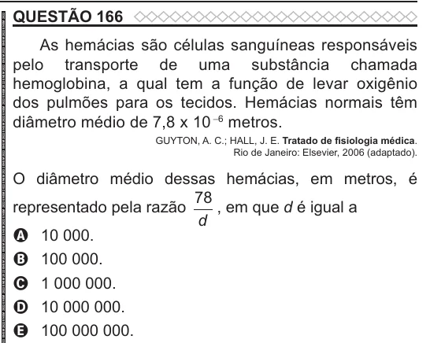

Texto extraído (pode conter ruído)

QUESTÃO 166  
As hemácias são células sanguíneas responsáveis  
pelo transporte de uma substância chamada  
hemoglobina, a qual tem a função de levar oxigênio  
dos pulmões para os tecidos. Hemácias normais têm  
diâmetro médio de 7,8 x 10 -6 metros.  
GUYTON, A. C.; HALL, J. E. Tratado de fisiologia médica.  
Rio de Janeiro: Elsevier, 2006 (adaptado).  
O diâmetro médio dessas hemácias, em metros, é  
78  
representado pela razão  
, em que d é igual a  
d  
A 10 000.  
B 100 000.  
C 1 000 000.  
D 10 000 000.  
E 100 000 000.

