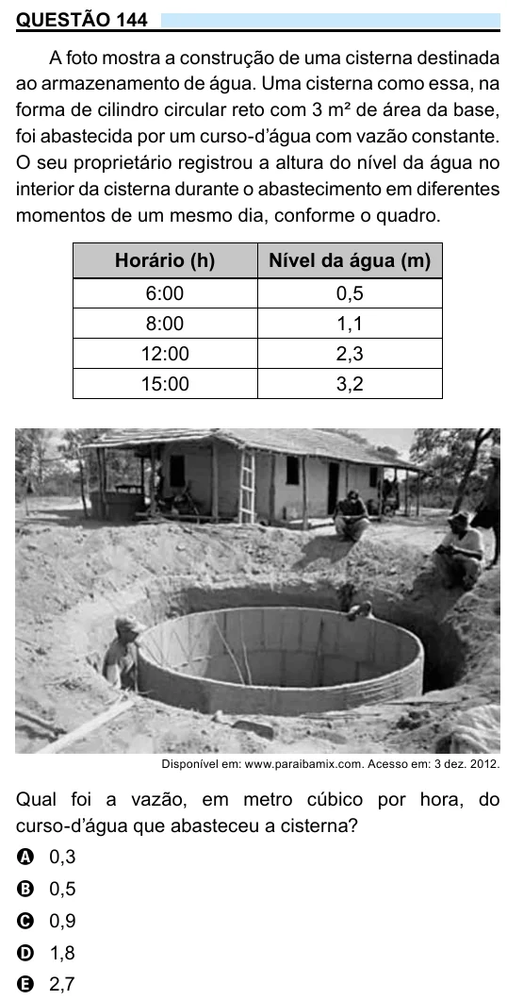

Texto extraído (pode conter ruído)

QUESTÃO 144  
A foto mostra a construção de uma cisterna destinada  
ao armazenamento de água. Uma cisterna como essa, na  
forma de cilindro circular reto com 3 m² de área da base,  
foi abastecida por um curso-d’água com vazão constante.  
O seu proprietário registrou a altura do nível da água no  
interior da cisterna durante o abastecimento em diferentes  
momentos de um mesmo dia, conforme o quadro.  
Horário (h)  
Nível da água (m)  
6:00  
0,5  
8:00  
1,1  
12:00  
2,3  
15:00  
3,2  
Disponível em: www.paraibamix.com. Acesso em: 3 dez. 2012.  
Qual foi a vazão, em metro cúbico por hora, do  
curso-d’água que abasteceu a cisterna?  
A 0,3  
B 0,5  
C 0,9  
D 1,8  
E 2,7

