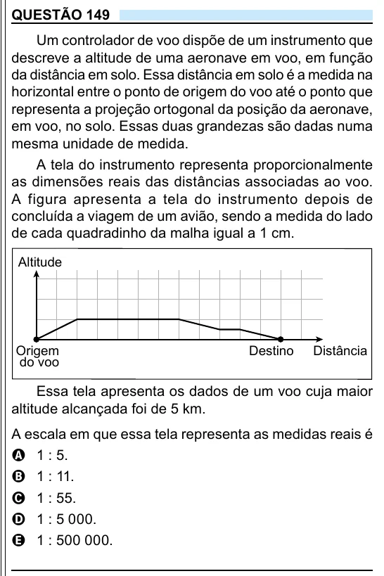

Texto extraído (pode conter ruído)

QUESTÃO 149  
Um controlador de voo dispõe de um instrumento que  
descreve a altitude de uma aeronave em voo, em função  
da distância em solo. Essa distância em solo é a medida na  
horizontal entre o ponto de origem do voo até o ponto que  
representa a projeção ortogonal da posição da aeronave,  
em voo, no solo. Essas duas grandezas são dadas numa  
mesma unidade de medida.  
A tela do instrumento representa proporcionalmente  
as dimensões reais das distâncias associadas ao voo.  
A figura apresenta a tela do instrumento depois de  
concluída a viagem de um avião, sendo a medida do lado  
de cada quadradinho da malha igual a 1 cm.  
Altitude  
Origem  
Destino  
Distância  
do voo  
Essa tela apresenta os dados de um voo cuja maior  
altitude alcançada foi de 5 km.  
A escala em que essa tela representa as medidas reais é  
A 1 : 5.  
B 1 : 11.  
C 1 : 55.  
D 1 : 5 000.  
E 1 : 500 000.

