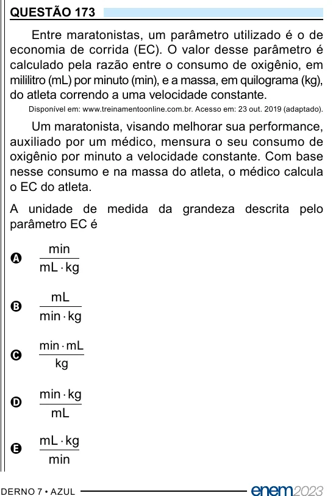

Texto extraído (pode conter ruído)

QUESTÃO 173  
Entre maratonistas, um parâmetro utilizado é o de  
economia de corrida (EC). O valor desse parâmetro é  
calculado pela razão entre o consumo de oxigênio, em  
mililitro (mL) por minuto (min), e a massa, em quilograma (kg),  
do atleta correndo a uma velocidade constante.  
Disponível em: www.treinamentoonline.com.br. Acesso em: 23 out. 2019 (adaptado).  
Um maratonista, visando melhorar sua performance,  
auxiliado por um médico, mensura o seu consumo de  
oxigênio por minuto a velocidade constante. Com base  
nesse consumo e na massa do atleta, o médico calcula  
o EC do atleta.  
A unidade de medida da grandeza descrita pelo  
parâmetro EC é  
min  
A  
mL ⋅ kg  
mL  
B  
min ⋅ kg  
min ⋅ mL  
C  
kg  
min ⋅ kg  
D  
mL  
mL ⋅ kg  
E  
min

