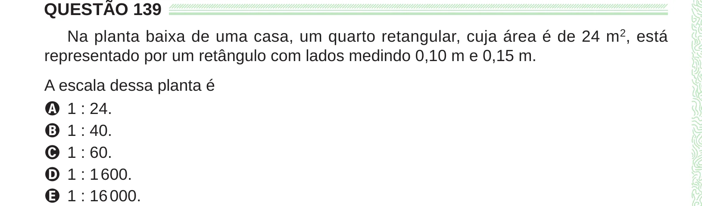

Texto extraído (pode conter ruído)

QUESTÃO 139  
Na planta baixa de uma casa, um quarto retangular, cuja área é de 24 m 2 , está  
representado por um retângulo com lados medindo 0,10 m e 0,15 m.  
A escala dessa planta é  
A 1 : 24.  
B 1 : 40.  
C 1 : 60.  
D 1 : 1 600.  
E 1 : 16 000.

