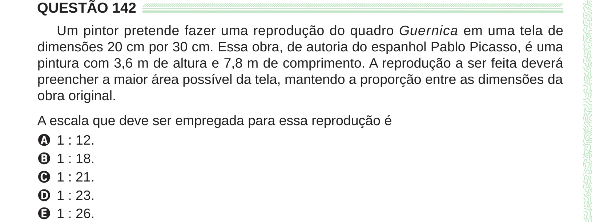

Texto extraído (pode conter ruído)

QUESTÃO 142  
Um pintor pretende fazer uma reprodução do quadro Guernica em uma tela de  
dimensões 20 cm por 30 cm. Essa obra, de autoria do espanhol Pablo Picasso, é uma  
pintura com 3,6 m de altura e 7,8 m de comprimento. A reprodução a ser feita deverá  
preencher a maior área possível da tela, mantendo a proporção entre as dimensões da  
obra original.  
A escala que deve ser empregada para essa reprodução é  
A 1 : 12.  
B 1 : 18.  
C 1 : 21.  
D 1 : 23.  
E 1 : 26.

