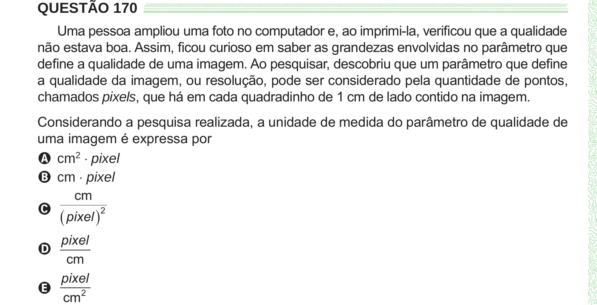

Texto extraído (pode conter ruído)

QUESTÃO 170  
Uma pessoa ampliou uma foto no computador e, ao imprimi-la, verificou que a qualidade  
não estava boa. Assim, ficou curioso em saber as grandezas envolvidas no parâmetro que  
define a qualidade de uma imagem. Ao pesquisar, descobriu que um parâmetro que define  
a qualidade da imagem, ou resolução, pode ser considerado pela quantidade de pontos,  
chamados pixels, que há em cada quadradinho de 1 cm de lado contido na imagem.  
Considerando a pesquisa realizada, a unidade de medida do parâmetro de qualidade de  
uma imagem é expressa por  
A cm 2 ⋅ pixel  
B cm ⋅ pixel  
cm  
C  
 pixel  2  
pixel  
D  
cm  
pixel  
E  
cm 2

