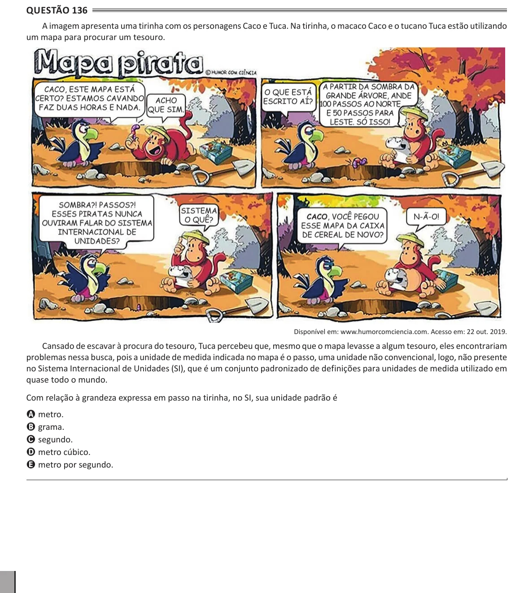

Texto extraído (pode conter ruído)

Questão 136  
A imagem apresenta uma tirinha com os personagens Caco e Tuca. Na tirinha, o macaco Caco e o tucano Tuca estão utilizando  
um mapa para procurar um tesouro.  
Disponível em: www.humorcomciencia.com. Acesso em: 22 out. 2019.  
Cansado de escavar à procura do tesouro, Tuca percebeu que, mesmo que o mapa levasse a algum tesouro, eles encontrariam  
problemas nessa busca, pois a unidade de medida indicada no mapa é o passo, uma unidade não convencional, logo, não presente  
no Sistema Internacional de Unidades (SI), que é um conjunto padronizado de definições para unidades de medida utilizado em  
quase todo o mundo.  
Com relação à grandeza expressa em passo na tirinha, no SI, sua unidade padrão é  
A metro.  
B grama.  
C segundo.  
D metro cúbico.  
E metro por segundo.

