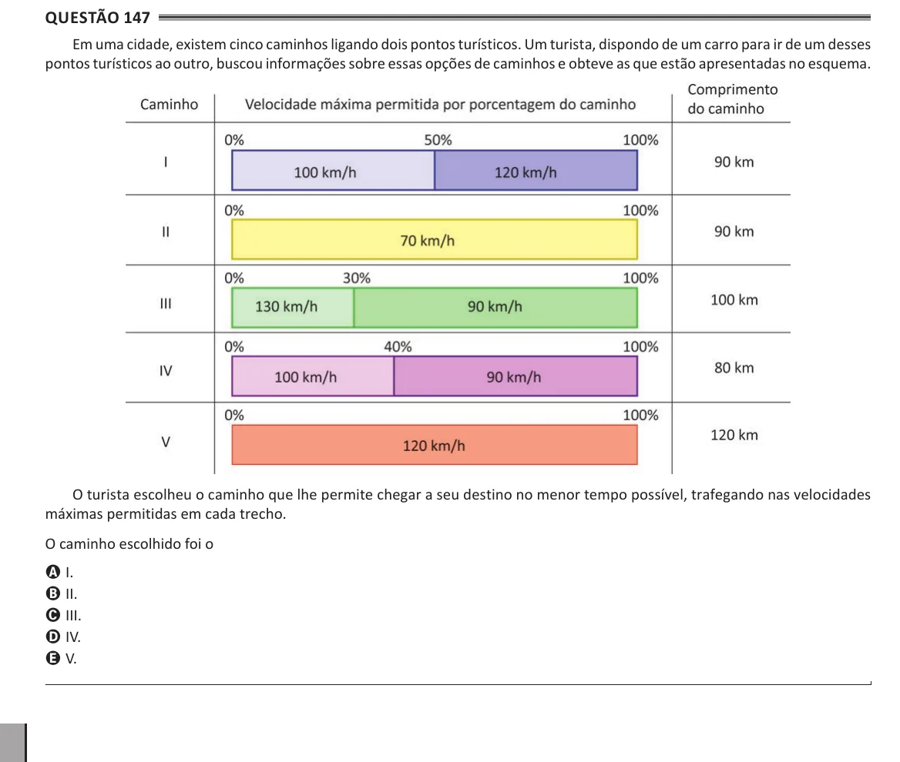

Texto extraído (pode conter ruído)

Questão 147  
Em uma cidade, existem cinco caminhos ligando dois pontos turísticos. Um turista, dispondo de um carro para ir de um desses  
pontos turísticos ao outro, buscou informações sobre essas opções de caminhos e obteve as que estão apresentadas no esquema.  
O turista escolheu o caminho que lhe permite chegar a seu destino no menor tempo possível, trafegando nas velocidades  
máximas permitidas em cada trecho.  
O caminho escolhido foi o  
A I.  
B II.  
C III.  
D IV.  
E V.

