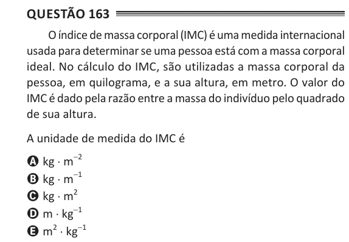

Texto extraído (pode conter ruído)

Questão 163  
O índice de massa corporal (IMC) é uma medida internacional  
usada para determinar se uma pessoa está com a massa corporal  
ideal. No cálculo do IMC, são utilizadas a massa corporal da  
pessoa, em quilograma, e a sua altura, em metro. O valor do  
IMC é dado pela razão entre a massa do indivíduo pelo quadrado  
de sua altura.  
A unidade de medida do IMC é  
A kg ⋅ m -2  
B kg ⋅ m -1  
C kg ⋅ m 2  
D m ⋅ kg -1  
E m 2 ⋅ kg -1

