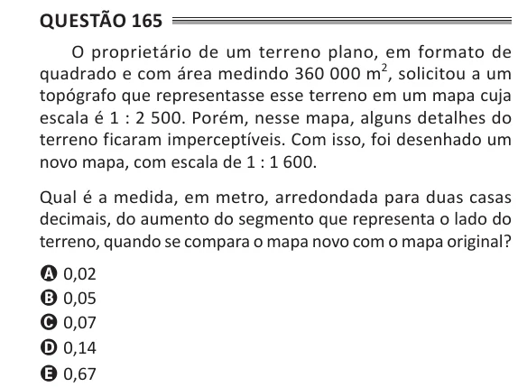

Texto extraído (pode conter ruído)

Questão 165  
O proprietário de um terreno plano, em formato de  
quadrado e com área medindo 360 000 m 2 , solicitou a um  
topógrafo que representasse esse terreno em um mapa cuja  
escala é 1 : 2 500. Porém, nesse mapa, alguns detalhes do  
terreno ficaram imperceptíveis. Com isso, foi desenhado um  
novo mapa, com escala de 1 : 1 600.  
Qual é a medida, em metro, arredondada para duas casas  
decimais, do aumento do segmento que representa o lado do  
terreno, quando se compara o mapa novo com o mapa original?  
A 0,02  
B 0,05  
C 0,07  
D 0,14  
E 0,67

