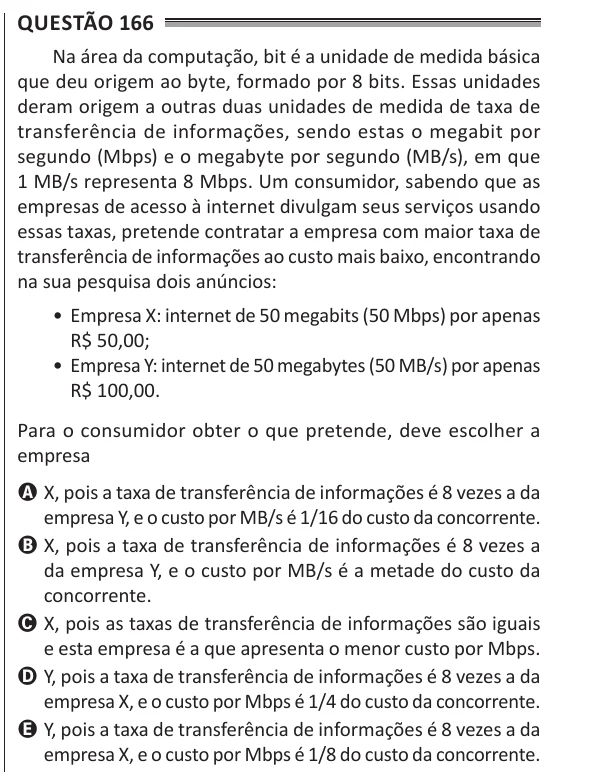

Texto extraído (pode conter ruído)

Questão 166  
Na área da computação, bit é a unidade de medida básica  
que deu origem ao byte, formado por 8 bits. Essas unidades  
deram origem a outras duas unidades de medida de taxa de  
transferência de informações, sendo estas o megabit por  
segundo (Mbps) e o megabyte por segundo (MB/s), em que  
1 MB/s representa 8 Mbps. Um consumidor, sabendo que as  
empresas de acesso à internet divulgam seus serviços usando  
essas taxas, pretende contratar a empresa com maior taxa de  
transferência de informações ao custo mais baixo, encontrando  
na sua pesquisa dois anúncios:  
• Empresa X: internet de 50 megabits (50 Mbps) por apenas  
R$ 50,00;  
• Empresa Y: internet de 50 megabytes (50 MB/s) por apenas  
R$ 100,00.  
Para o consumidor obter o que pretende, deve escolher a  
empresa  
A X, pois a taxa de transferência de informações é 8 vezes a da  
empresa Y, e o custo por MB/s é 1/16 do custo da concorrente.  
B X, pois a taxa de transferência de informações é 8 vezes a  
da empresa Y, e o custo por MB/s é a metade do custo da  
concorrente.  
C X, pois as taxas de transferência de informações são iguais  
e esta empresa é a que apresenta o menor custo por Mbps.  
D Y, pois a taxa de transferência de informações é 8 vezes a da  
empresa X, e o custo por Mbps é 1/4 do custo da concorrente.  
E Y, pois a taxa de transferência de informações é 8 vezes a da  
empresa X, e o custo por Mbps é 1/8 do custo da concorrente.

