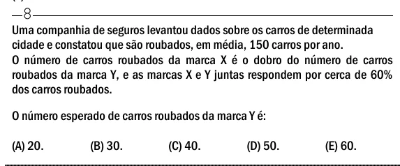

Texto extraído (pode conter ruído)

8  
Uma companhia de seguros levantou dados sobre os carros de determinada  
cidade e constatou que são roubados, em média, 150 carros por ano.  
O número de carros roubados da marca X é o dobro do número de carros  
roubados da marca Y, e as marcas X e Y juntas respondem por cerca de 60%  
dos carros roubados.  
O número esperado de carros roubados da marca Y é:  
(A) 20.  
(B) 30.  
(C) 40.  
(D) 50.  
(E) 60.

