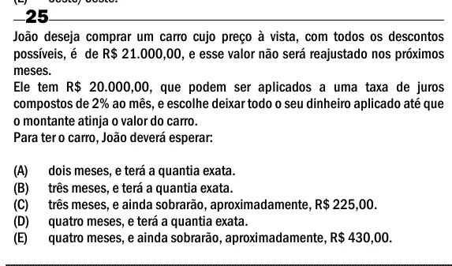

Texto extraído (pode conter ruído)

25  
João deseja comprar um carro cujo preço à vista, com todos os descontos  
possíveis, é de R$ 21.000,00, e esse valor não será reajustado nos próximos  
meses.  
Ele tem R$ 20.000,00, que podem ser aplicados a uma taxa de juros  
compostos de 2% ao mês, e escolhe deixar todo o seu dinheiro aplicado até que  
o montante atinja o valor do carro.  
Para ter o carro, João deverá esperar:  
(A)  
dois meses, e terá a quantia exata.  
(B)  
três meses, e terá a quantia exata.  
(C)  
três meses, e ainda sobrarão, aproximadamente, R$ 225,00.  
(D)  
quatro meses, e terá a quantia exata.  
(E)  
quatro meses, e ainda sobrarão, aproximadamente, R$ 430,00.

