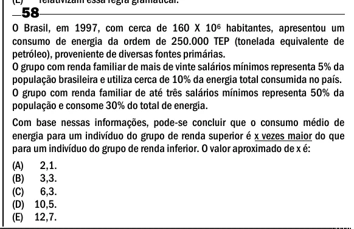

Texto extraído (pode conter ruído)

58  
O Brasil, em 1997, com cerca de 160 X 10 6 habitantes, apresentou um  
consumo de energia da ordem de 250.000 TEP (tonelada equivalente de  
petróleo), proveniente de diversas fontes primárias.  
O grupo com renda familiar de mais de vinte salários mínimos representa 5% da  
população brasileira e utiliza cerca de 10% da energia total consumida no país.  
O grupo com renda familiar de até três salários mínimos representa 50% da  
população e consome 30% do total de energia.  
Com base nessas informações, pode-se concluir que o consumo médio de  
energia para um indivíduo do grupo de renda superior é x vezes maior do que  
para um indivíduo do grupo de renda inferior. O valor aproximado de x é:  
(A) 2,1.  
(B) 3,3.  
(C) 6,3.  
(D) 10,5.  
(E) 12,7.

