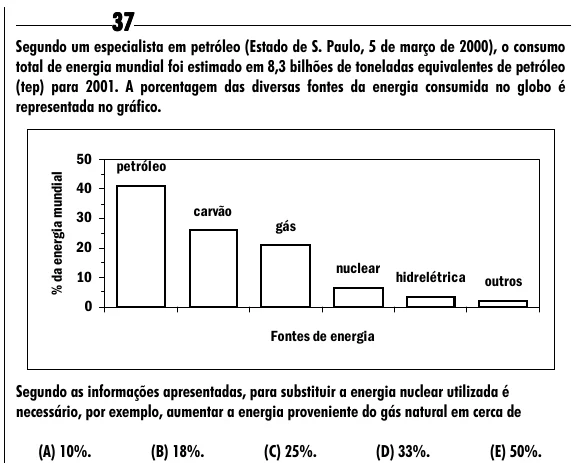

Texto extraído (pode conter ruído)

37  
Segundo um especialista em petróleo (Estado de S. Paulo, 5 de março de 2000), o consumo  
total de energia mundial foi estimado em 8,3 bilhões de toneladas equivalentes de petróleo  
(tep) para 2001. A porcentagem das diversas fontes da energia consumida no globo é  
representada no gráfico.  
50  
petróleo  
% da energia mundial  
40  
carvão  
30  
gás  
20  
nuclear  
10  
hidrelétrica  
outros  
0  
Fontes de energia  
Segundo as informações apresentadas, para substituir a energia nuclear utilizada é  
necessário, por exemplo, aumentar a energia proveniente do gás natural em cerca de  
(A) 10%.  
(B) 18%.  
(C) 25%.  
(D) 33%.  
(E) 50%.

