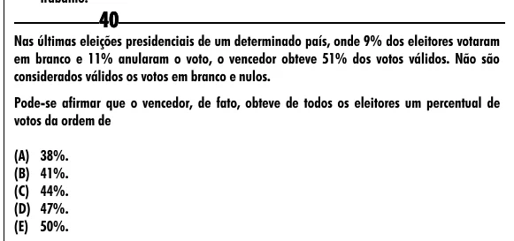

Texto extraído (pode conter ruído)

40  
Nas últimas eleições presidenciais de um determinado país, onde 9% dos eleitores votaram  
em branco e 11% anularam o voto, o vencedor obteve 51% dos votos válidos. Não são  
considerados válidos os votos em branco e nulos.  
Pode-se afirmar que o vencedor, de fato, obteve de todos os eleitores um percentual de  
votos da ordem de  
(A) 38%.  
(B) 41%.  
(C) 44%.  
(D) 47%.  
(E) 50%.

