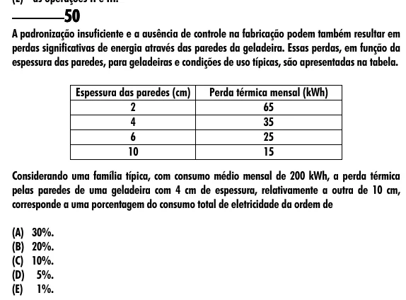

Texto extraído (pode conter ruído)

50  
A padronização insuficiente e a ausência de controle na fabricação podem também resultar em  
perdas significativas de energia através das paredes da geladeira. Essas perdas, em função da  
espessura das paredes, para geladeiras e condições de uso típicas, são apresentadas na tabela.  
Espessura das paredes (cm)  
Perda térmica mensal (kWh)  
2  
65  
4  
35  
6  
25  
10  
15  
Considerando uma família típica, com consumo médio mensal de 200 kWh, a perda térmica  
pelas paredes de uma geladeira com 4 cm de espessura, relativamente a outra de 10 cm,  
corresponde a uma porcentagem do consumo total de eletricidade da ordem de  
(A) 30%.  
(B) 20%.  
(C) 10%.  
(D) 5%.  
(E) 1%.

