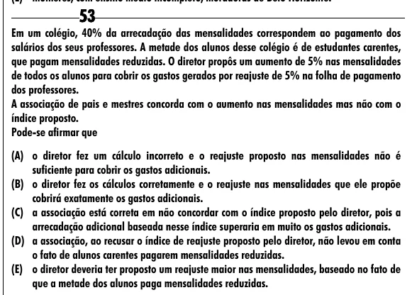

Texto extraído (pode conter ruído)

53  
Em um colégio, 40% da arrecadação das mensalidades correspondem ao pagamento dos  
salários dos seus professores. A metade dos alunos desse colégio é de estudantes carentes,  
que pagam mensalidades reduzidas. O diretor propôs um aumento de 5% nas mensalidades  
de todos os alunos para cobrir os gastos gerados por reajuste de 5% na folha de pagamento  
dos professores.  
A associação de pais e mestres concorda com o aumento nas mensalidades mas não com o  
índice proposto.  
Pode-se afirmar que  
(A) o diretor fez um cálculo incorreto e o reajuste proposto nas mensalidades não é  
suficiente para cobrir os gastos adicionais.  
(B) o diretor fez os cálculos corretamente e o reajuste nas mensalidades que ele propõe  
cobrirá exatamente os gastos adicionais.  
(C) a associação está correta em não concordar com o índice proposto pelo diretor, pois a  
arrecadação adicional baseada nesse índice superaria em muito os gastos adicionais.  
(D) a associação, ao recusar o índice de reajuste proposto pelo diretor, não levou em conta  
o fato de alunos carentes pagarem mensalidades reduzidas.  
(E) o diretor deveria ter proposto um reajuste maior nas mensalidades, baseado no fato de  
que a metade dos alunos paga mensalidades reduzidas.

