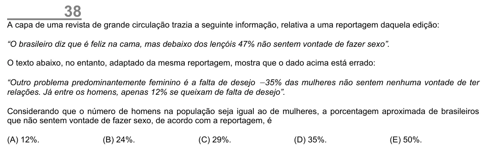

Texto extraído (pode conter ruído)

38  
A capa de uma revista de grande circulação trazia a seguinte informação, relativa a uma reportagem daquela edição:  
“O brasileiro diz que é feliz na cama, mas debaixo dos lençóis 47% não sentem vontade de fazer sexo”.  
O texto abaixo, no entanto, adaptado da mesma reportagem, mostra que o dado acima está errado:  
“Outro problema predominantemente feminino é a falta de desejo − 35% das mulheres não sentem nenhuma vontade de ter  
relações. Já entre os homens, apenas 12% se queixam de falta de desejo”.  
Considerando que o número de homens na população seja igual ao de mulheres, a porcentagem aproximada de brasileiros  
que não sentem vontade de fazer sexo, de acordo com a reportagem, é  
(A) 12%.  
(B) 24%.  
(C) 29%.  
(D) 35%.  
(E) 50%.

