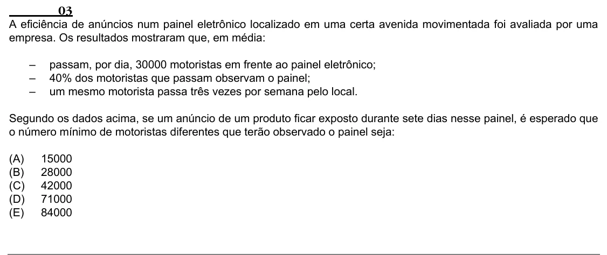

Texto extraído (pode conter ruído)

03  
A eficiência de anúncios num painel eletrônico localizado em uma certa avenida movimentada foi avaliada por uma  
empresa. Os resultados mostraram que, em média:  
–  
passam, por dia, 30000 motoristas em frente ao painel eletrônico;  
–  
40% dos motoristas que passam observam o painel;  
–  
um mesmo motorista passa três vezes por semana pelo local.  
Segundo os dados acima, se um anúncio de um produto ficar exposto durante sete dias nesse painel, é esperado que  
o número mínimo de motoristas diferentes que terão observado o painel seja:  
(A)  
15000  
(B)  
28000  
(C)  
42000  
(D)  
71000  
(E)  
84000

