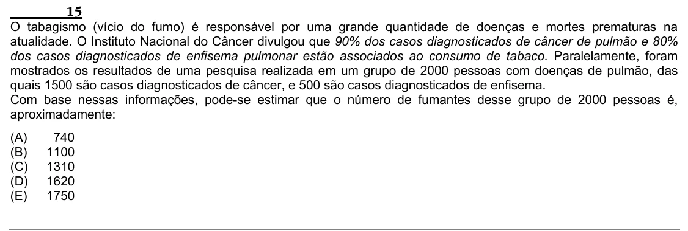

Texto extraído (pode conter ruído)

15  
O tabagismo (vício do fumo) é responsável por uma grande quantidade de doenças e mortes prematuras na  
atualidade. O Instituto Nacional do Câncer divulgou que 90% dos casos diagnosticados de câncer de pulmão e 80%  
dos casos diagnosticados de enfisema pulmonar estão associados ao consumo de tabaco. Paralelamente, foram  
mostrados os resultados de uma pesquisa realizada em um grupo de 2000 pessoas com doenças de pulmão, das  
quais 1500 são casos diagnosticados de câncer, e 500 são casos diagnosticados de enfisema.  
Com base nessas informações, pode-se estimar que o número de fumantes desse grupo de 2000 pessoas é,  
aproximadamente:  
(A)  
740  
(B)  
1100  
(C)  
1310  
(D)  
1620  
(E)  
1750

