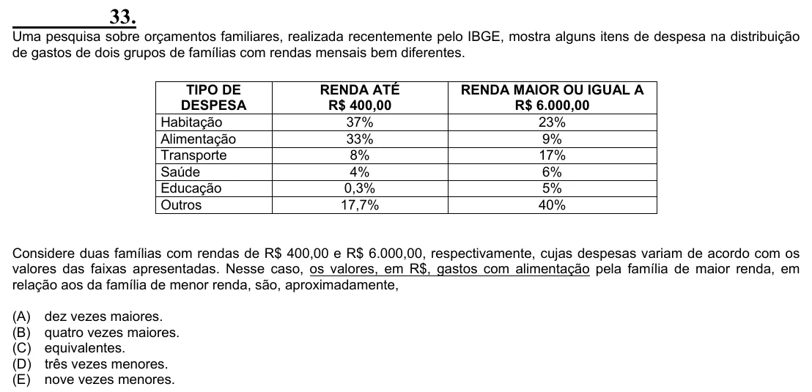

Texto extraído (pode conter ruído)

33.  
Uma pesquisa sobre orçamentos familiares, realizada recentemente pelo IBGE, mostra alguns itens de despesa na distribuição  
de gastos de dois grupos de famílias com rendas mensais bem diferentes.  
TIPO DE  
RENDA ATÉ  
RENDA MAIOR OU IGUAL A  
DESPESA  
R$ 400,00  
R$ 6.000,00  
Habitação  
37%  
23%  
Alimentação  
33%  
9%  
Transporte  
8%  
17%  
Saúde  
4%  
6%  
Educação  
0,3%  
5%  
Outros  
17,7%  
40%  
Considere duas famílias com rendas de R$ 400,00 e R$ 6.000,00, respectivamente, cujas despesas variam de acordo com os  
valores das faixas apresentadas. Nesse caso, os valores, em R$, gastos com alimentação pela família de maior renda, em  
relação aos da família de menor renda, são, aproximadamente,  
(A)  
dez vezes maiores.  
(B)  
quatro vezes maiores.  
(C)  
equivalentes.  
(D)  
três vezes menores.  
(E)  
nove vezes menores.

