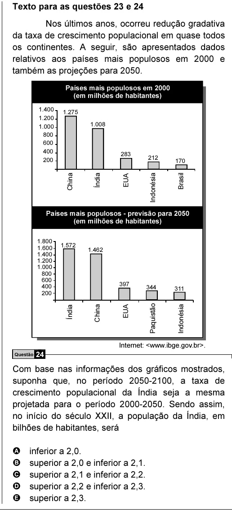

Texto extraído (pode conter ruído)

Texto para as questões 23 e 24  
Nos últimos anos, ocorreu redução gradativa  
da taxa de crescimento populacional em quase todos  
os continentes. A seguir, são apresentados dados  
relativos aos países mais populosos em 2000 e  
também as projeções para 2050.  
Países mais populosos em 2000  
(em milhões de habitantes)  
1.400  
1.275  
1.200  
1.008  
1.000  
800  
600  
400  
283  
212  
200  
170  
China  
Índia  
EUA  
Indonésia  
Brasil  
Países mais populosos - previsão para 2050  
(em milhões de habitantes)  
1.800  
1.572  
1.600  
1.462  
1.400  
1.200  
1.000  
800  
600  
397  
400  
344  
311  
200  
Índia  
China  
EUA  
Paquistão  
Indonésia  
Internet: <www.ibge.gov.br>.  
Questão 24  
Com base nas informações dos gráficos mostrados,  
suponha que, no período 2050-2100, a taxa de  
crescimento populacional da Índia seja a mesma  
projetada para o período 2000-2050. Sendo assim,  
no início do século XXII, a população da Índia, em  
bilhões de habitantes, será  
A  
inferior a 2,0.  
B  
superior a 2,0 e inferior a 2,1.  
C  
superior a 2,1 e inferior a 2,2.  
D  
superior a 2,2 e inferior a 2,3.  
E  
superior a 2,3.

