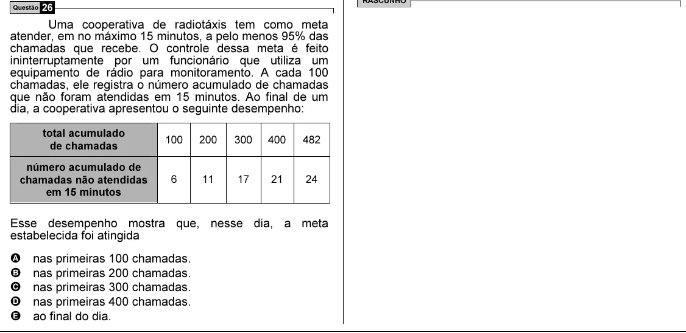

Texto extraído (pode conter ruído)

Questão 26  
Uma cooperativa de radiotáxis tem como meta  
atender, em no máximo 15 minutos, a pelo menos 95% das  
chamadas que recebe. O controle dessa meta é feito  
ininterruptamente por um funcionário que utiliza um  
equipamento de rádio para monitoramento. A cada 100  
chamadas, ele registra o número acumulado de chamadas  
que não foram atendidas em 15 minutos. Ao final de um  
dia, a cooperativa apresentou o seguinte desempenho:  
total acumulado  
100  
200  
300  
400  
482  
de chamadas  
número acumulado de  
chamadas não atendidas  
6  
11  
17  
21  
24  
em 15 minutos  
Esse desempenho mostra que, nesse dia, a meta  
estabelecida foi atingida  
A  
nas primeiras 100 chamadas.  
B  
nas primeiras 200 chamadas.  
C  
nas primeiras 300 chamadas.  
D  
nas primeiras 400 chamadas.  
E  
ao final do dia.

