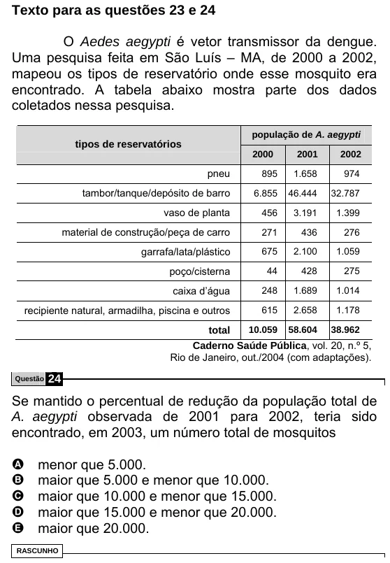

Texto extraído (pode conter ruído)

Texto para as questões 23 e 24  
O Aedes aegypti é vetor transmissor da dengue.  
Uma pesquisa feita em São Luís – MA, de 2000 a 2002,  
mapeou os tipos de reservatório onde esse mosquito era  
encontrado. A tabela abaixo mostra parte dos dados  
coletados nessa pesquisa.  
população de A. aegypti  
tipos de reservatórios  
2000  
2001  
2002  
pneu  
895  
1.658  
974  
tambor/tanque/depósito de barro  
6.855  
46.444  
32.787  
vaso de planta  
456  
3.191  
1.399  
material de construção/peça de carro  
271  
436  
276  
garrafa/lata/plástico  
675  
2.100  
1.059  
poço/cisterna  
44  
428  
275  
caixa d’água  
248  
1.689  
1.014  
recipiente natural, armadilha, piscina e outros  
615  
2.658  
1.178  
total  
10.059  
58.604  
38.962  
Caderno Saúde Pública, vol. 20, n.º 5,  
Rio de Janeiro, out./2004 (com adaptações).  
Questão  
24  
Se mantido o percentual de redução da população total de  
A. aegypti observada de 2001 para 2002, teria sido  
encontrado, em 2003, um número total de mosquitos  
A  
menor que 5.000.  
maior que 5.000 e menor que 10.000.  
B  
C  
maior que 10.000 e menor que 15.000.  
maior que 15.000 e menor que 20.000.  
D  
maior que 20.000.  
E  
RASCUNHO

