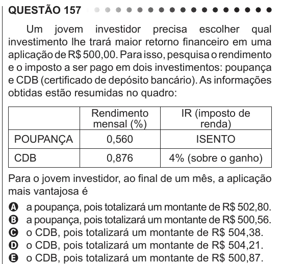

Texto extraído (pode conter ruído)

QUESTÃO 157  
Um jovem investidor precisa escolher qual  
investimento lhe trará maior retorno financeiro em uma  
aplicação de R$ 500,00. Para isso, pesquisa o rendimento  
e o imposto a ser pago em dois investimentos: poupança  
e CDB (certificado de depósito bancário). As informações  
obtidas estão resumidas no quadro:  
Rendimento  
IR (imposto de  
mensal (%)  
renda)  
POUPANÇA  
0,560  
ISENTO  
CDB  
0,876  
4% (sobre o ganho)  
Para o jovem investidor, ao final de um mês, a aplicação  
mais vantajosa é  
A a poupança, pois totalizará um montante de R$ 502,80.  
B a poupança, pois totalizará um montante de R$ 500,56.  
C o CDB, pois totalizará um montante de R$ 504,38.  
D o CDB, pois totalizará um montante de R$ 504,21.  
E o CDB, pois totalizará um montante de R$ 500,87.

