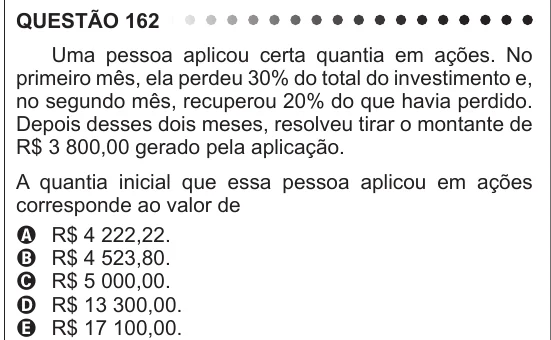

Texto extraído (pode conter ruído)

QUESTÃO 162  
Uma pessoa aplicou certa quantia em ações. No  
primeiro mês, ela perdeu 30% do total do investimento e,  
no segundo mês, recuperou 20% do que havia perdido.  
Depois desses dois meses, resolveu tirar o montante de  
R$ 3 800,00 gerado pela aplicação.  
A quantia inicial que essa pessoa aplicou em ações  
corresponde ao valor de  
A R$ 4 222,22.  
B R$ 4 523,80.  
C R$ 5 000,00.  
D R$ 13 300,00.  
E R$ 17 100,00.

